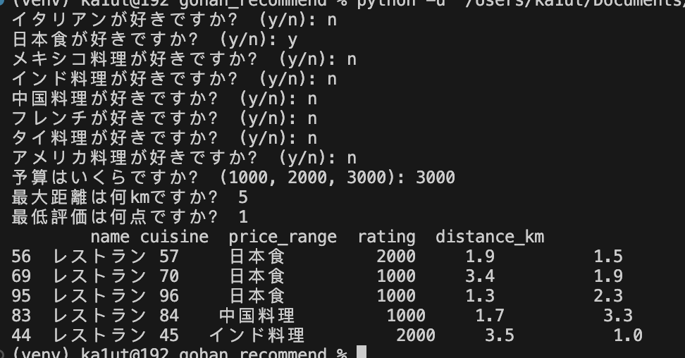

# レコメンドシステム
- Pythonを使用している
    

```bash
git clone

# 仮想環境の作成
python -m venv venv

# 仮想環境の有効化
source venv/bin/activate  # macOS/Linux
.\venv\Scripts\activate  # Windows

# パッケージのインストール
pip install -r requirements.txt

# アプリの実行
python3 main.py
```

# requiremets.txtの更新
requirements.txtを一度消すこと
``` bash
rm requirements.txt

pip install pipreqs

# 現在のディレクトリを確認
pwd
# 出力例: /Users/username/project

# プロジェクトディレクトリで pipreqs を実行
pipreqs /Users/username/project

```